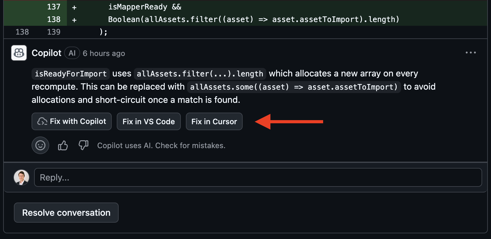

# GitHub PR Copilot Comment Enhancer

A browser extension that improves the GitHub pull request review workflow by adding one-click actions next to Copilot review comments.

When GitHub shows a `Fix with Copilot` action, this extension injects additional IDE-specific buttons so you can send the review prompt directly into your preferred editor chat.

## Why This Extension

GitHub Copilot review comments are useful, but switching context and manually copying feedback into your editor is repetitive.

This extension streamlines the loop:

1. Read Copilot feedback in a PR.
2. Click `Fix in VS Code` or `Fix in Cursor` directly from the comment.
3. Continue implementation in your local IDE with the prompt already prepared.



## Features

- Enhances GitHub PR pages (`https://github.com/*/*/pull/*`) in real time.
- Detects Copilot review comment action rows and injects extra IDE actions.
- Builds prompt context from the review comment text and file path.
- Supports configurable IDE targets:
	- VS Code
	- Cursor
- Settings page with persistent per-IDE enable/disable toggles.
- Popup shortcuts for:
	- Opening extension settings
	- Supporting the project
	- Opening the project repository

## Store Links

- Chrome Web Store: `TBD`
- Firefox Add-ons: `TBD`

## How It Works

- A content script monitors GitHub PR pages.
- It looks for Copilot comment containers and `Fix with Copilot` buttons.
- For each configured IDE, it injects a matching action button.
- Clicking an action opens an IDE deeplink with the generated prompt:
	- VS Code via `vscode://GitHub.Copilot-Chat?...`
	- Cursor via `cursor://anysphere.cursor-deeplink/prompt?...`

The enabled IDE list is stored in extension storage and controlled from the options page.

## Tech Stack

- [WXT](https://wxt.dev/)
- [React](https://react.dev/)
- [TypeScript](https://www.typescriptlang.org/)
- [Tailwind CSS](https://tailwindcss.com/)
- [Biome](https://biomejs.dev/)
- [pnpm](https://pnpm.io/)

## Development

1. Install dependencies:

```bash
pnpm install
```

2. Start development:

```bash
pnpm dev
```

## Scripts

- `pnpm dev` - Run extension in development mode (Chrome)
- `pnpm dev:firefox` - Run extension in development mode (Firefox)
- `pnpm build` - Build production bundle (Chrome)
- `pnpm build:firefox` - Build production bundle (Firefox)
- `pnpm zip` - Create Chrome zip package
- `pnpm zip:firefox` - Create Firefox zip package
- `pnpm lint` - Run Biome checks
- `pnpm type:check` - Run TypeScript type checking

## Project Structure

```text
.
├── entrypoints/
│   ├── background.ts
│   ├── content.ts
│   ├── lib/
│   │   ├── CopilotCommentButtonEnhancer.ts
│   │   ├── ideConfig.ts
│   │   └── ideSettingsStorage.ts
│   ├── options/
│   └── popup/
├── public/
├── wxt.config.ts
└── package.json
```

## Contributing

Issues and pull requests are always welcome.

## Privacy Policy

This extension is designed to keep your data local and minimal.

- No personal data is collected by the extension author.
- No analytics, tracking pixels, or telemetry are included.
- No extension-controlled backend/server is used.
- The extension does not transmit your data to third-party APIs managed by this project.

### What data is processed

- On GitHub pull request pages, the extension reads visible Copilot review comment text and related file path context in order to build IDE deeplinks.
- The extension stores only your IDE selection settings (enabled/disabled IDEs) in browser extension storage.

### Where data is stored

- Settings are stored locally in extension storage.
- Data is not synced to any external service by this extension.

### External links and IDE deeplinks

- When you click an action button (for example, `Fix in VS Code` or `Fix in Cursor`), the extension opens the corresponding deeplink URL with prompt text.
- That deeplink is then handled by your installed IDE according to that IDE's own privacy policy and behavior.

### Permissions

- `storage`: used only to persist extension settings.
- Host matching for GitHub pull requests: used only to run the content script on matching PR pages.

If you have privacy questions, open an issue in this repository.
